<p align="center">
  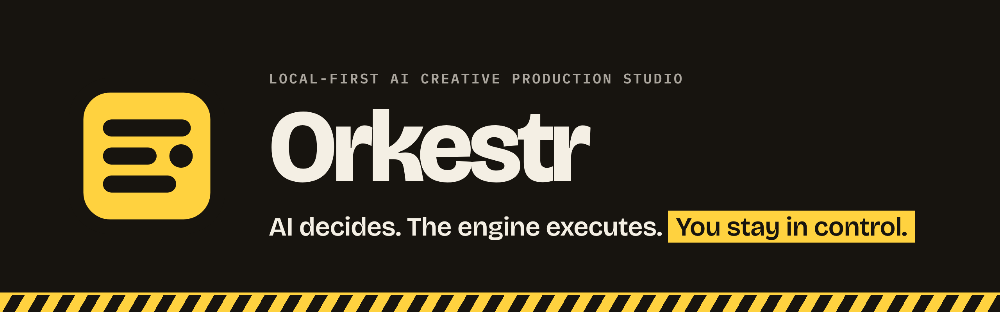
</p>

<p align="center">
  <b>Plan a commercial, a social cut, a homepage loop or a poster with an AI Director — then render it on your own
  machine with tools that are actually verified to work, and approve every paid or creative step yourself.</b>
</p>

<p align="center">
  <a href="#quick-start">Quick start</a> ·
  <a href="#tour">Tour</a> ·
  <a href="#features">Features</a> ·
  <a href="#how-it-works">How it works</a> ·
  <a href="#documentation">Docs</a> ·
  <a href="#design-system">Design system</a> ·
  <a href="#contributing">Contributing</a>
</p>

---

<p align="center">
  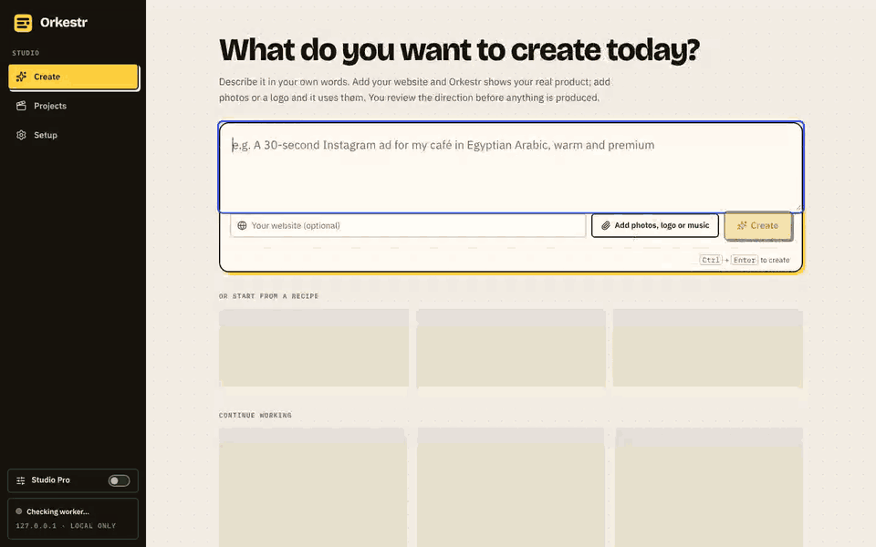
</p>

## Why Orkestr

Most "AI video" tools are a prompt box glued to a cloud bill. Orkestr is the opposite:

- **Local-first.** Single user, binds to `127.0.0.1`, no cloud backend. State lives in SQLite plus a
  content-addressed asset store on your disk.
- **Honest about capabilities.** Every tool is wrapped by an adapter that only exposes operations verified on *this*
  machine. Missing tools are shown as unavailable with the reason — never faked. Scenes that would need an
  unavailable generator get a marked placeholder with a burned-in `DRAFT` banner.
- **You hold the purse strings.** Nothing paid runs without your approval or a bounded budget you preauthorize.
  Unknown prices are labelled *unknown*, never guessed.
- **AI plans, a deterministic engine executes.** The AI Director proposes a schema-validated plan; Orkestr builds
  the workflow graph itself and a durable worker runs it, with retries, caching and selective re-renders.

## How it feels

1. **Say what you want.** On the home screen, describe it in plain words, for example *"A 30-second commercial
   for my café app in Egyptian Arabic, kafeeh.com"*. You can add photos, a logo or a music track, or pick a recipe.
2. **Review the direction.** Orkestr reads your website: brand colours, headings, call to action, logo and real
   screens. It picks a recipe and writes the storyboard, either with the AI Director or the free recipe planner.
   Every line is editable in place. Creative checks have already fixed the timing, and they flag anything that
   needs you, such as missing copy or a number you haven't confirmed.
3. **Make it.** Confirm the text is accurate, choose a voice if you want one, and press **Make it**. Production
   runs in the background with real progress. Any decision that needs you (paid voice, pronunciation, captions,
   final cut) appears inline.
4. **Refine and export.** Say "make it 15 seconds", "slower, more cinematic", "bigger text", "make an Instagram
   version" or "change the call to action to …". Only what changed re-renders. Earlier versions can be restored.

The flow editor, storyboard, render queue and logs are still there under **Studio Pro**, a switch in the sidebar.
Both modes work on the same projects, engine and runs. Measurements are in
[docs/UX_MEASUREMENTS.md](docs/UX_MEASUREMENTS.md).

| Create | Direction review | Producing, with decisions inline |
| --- | --- | --- |
| [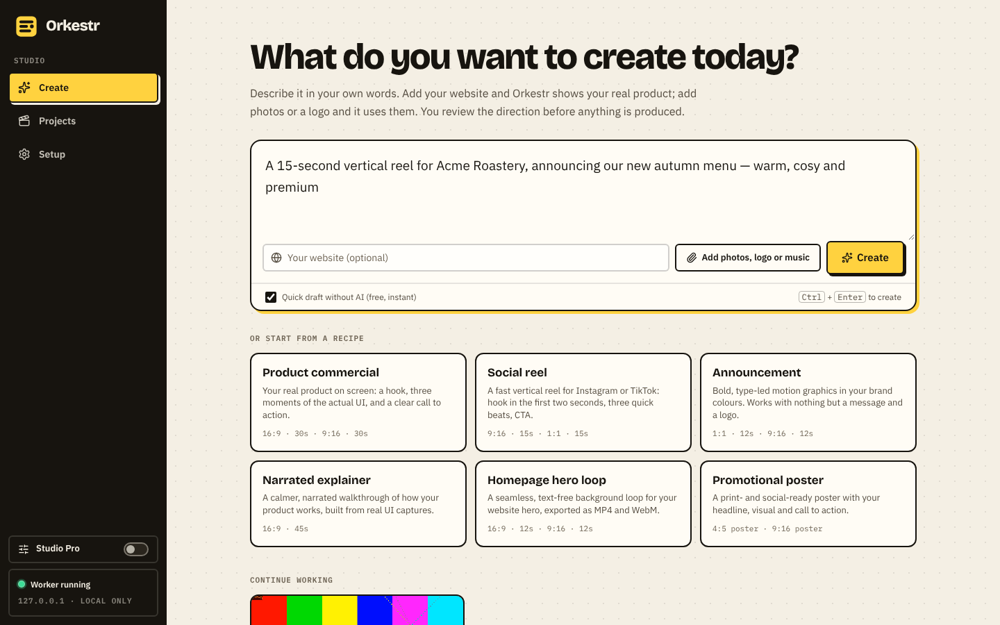](docs/screenshots/after-home.png) | [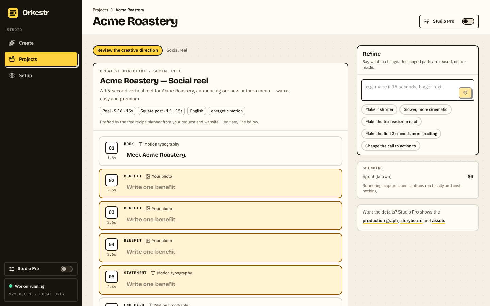](docs/screenshots/after-direction.png) | [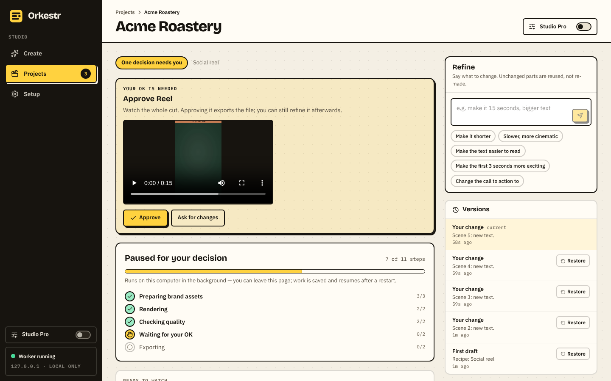](docs/screenshots/after-approval.png) |

## Quick start

**Requirements:** Node **22.13+**, FFmpeg/FFprobe on `PATH`. Windows 10/11, macOS and Linux all work (the optional
ArtCraft adapters and the automatic whisper.cpp install are Windows-only).

```bash
git clone https://github.com/midoghranek/Orkestr.git && cd Orkestr
npm install
npx playwright install chromium   # real UI captures (free)
npm run discover                  # probe your tools → data/capabilities.json (spends nothing)
npm run seed:demo                 # optional: the "Acme Café (demo)" project with dummy media
npm run dev                       # studio + worker → http://127.0.0.1:4317
```

`npm run dev` starts two processes: the Next.js studio (UI + local API) and the **worker**, the only process that
executes jobs. Stop with <kbd>Ctrl</kbd>+<kbd>C</kbd>; running jobs are re-queued and resume on the next start.
For an optimized local build: `npm run build && npm run start`.

**Optional, free downloads** (from Settings or the API): Whisper models for captions (`base` 142 MB; `small` /
`medium` for Egyptian Arabic) and Remotion's Chrome Headless Shell (~100 MB, fetched on the first render).

**Optional, paid providers:** Settings → Credentials → ElevenLabs API key (voiceover). Keys are encrypted at rest
(AES-256-GCM, `data/secret.key`) and never returned by the API.

### The demo project

`npm run seed:demo` creates **Acme Café (demo)** — a fictional brand with dummy data only: invented "demo claims",
logos and stills generated with FFmpeg, a test-pattern clip and a test tone. It also accepts a hand-written plan
fixture (clearly labelled, *not* AI-generated) through the normal code path, so you get a real storyboard and a
validated 14-node workflow to explore without spending anything. The screenshots below were taken with it; the
"How it feels" shots use a fictional *Acme Roastery* reel built from the demo photos with the free recipe planner.

## Tour (Studio Pro)

| Control room — studio status and decisions | AI Director — the plan as a call sheet |
| --- | --- |
| [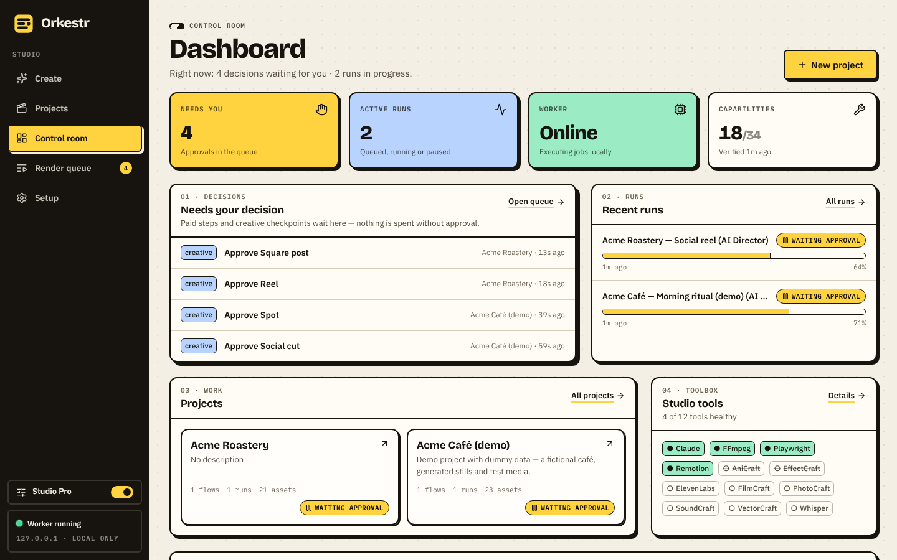](docs/screenshots/dashboard.png) | [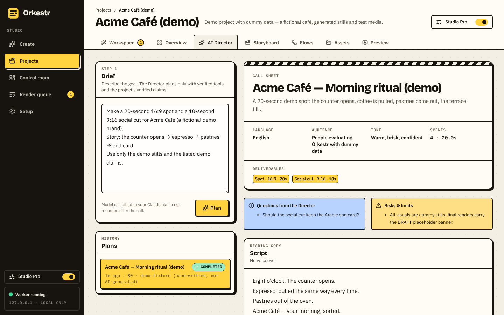](docs/screenshots/director.png) |
| **Storyboard** — scenes, narration, approvals | **Flow editor** — typed DAG with live validation |
| [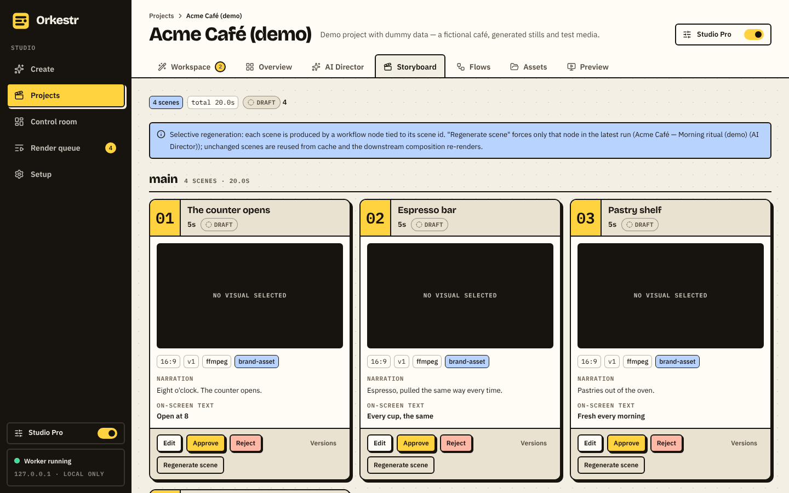](docs/screenshots/storyboard.png) | [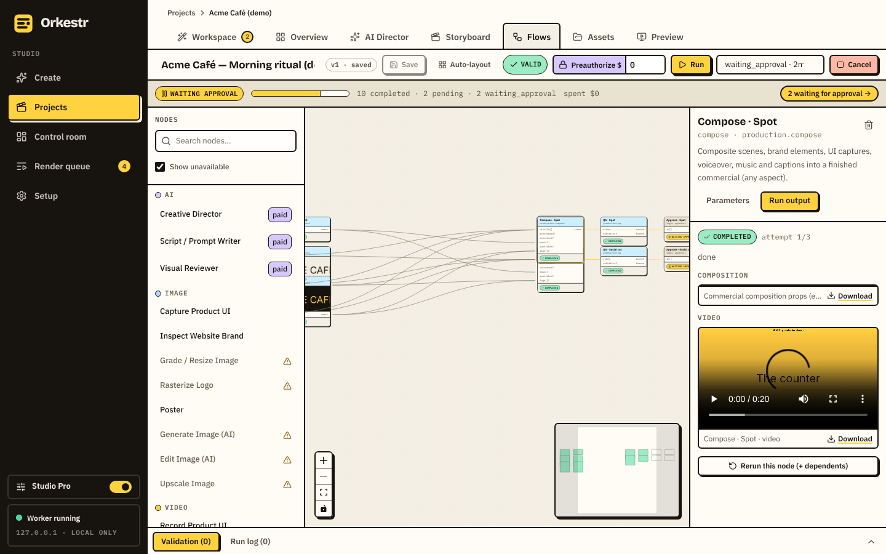](docs/screenshots/flow-editor.png) |
| **Render queue** — spend and creative approvals | **Assets** — library, upload, import, lineage |
| [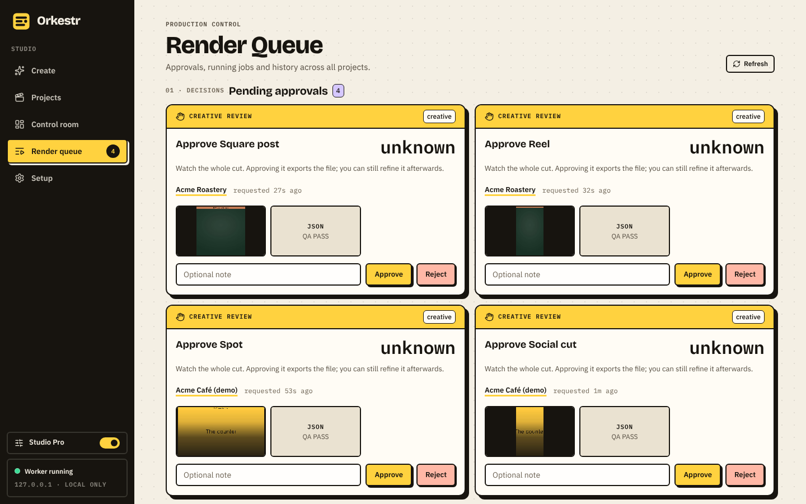](docs/screenshots/queue.png) | [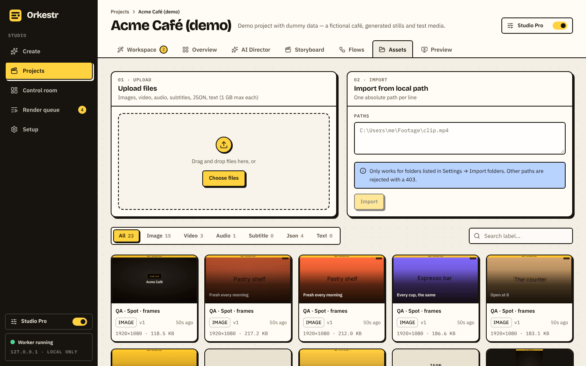](docs/screenshots/assets.png) |
| **Preview** — player, subtitles, scene timeline, QA | **Settings** — capability matrix, models, keys, budgets |
| [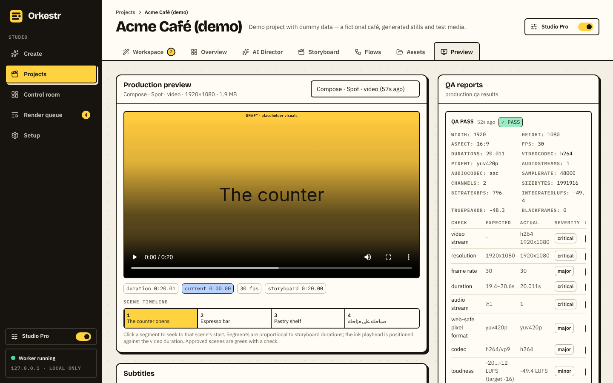](docs/screenshots/preview.png) | [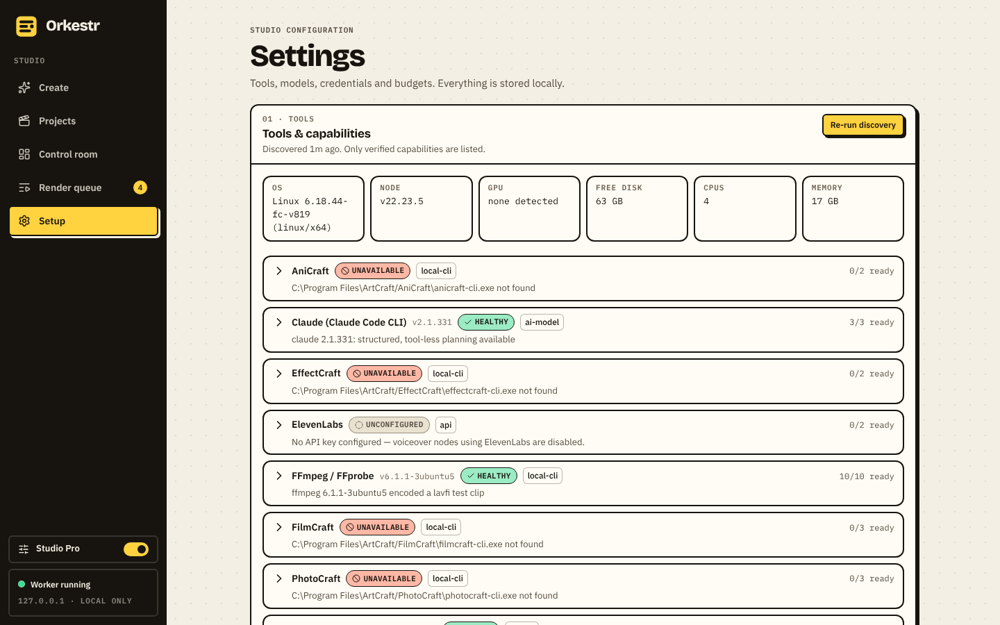](docs/screenshots/settings.png) |

<details>
<summary><b>Flow editor in motion</b> — auto-layout, search the palette, add a node, live validation, inspector</summary>
<br>
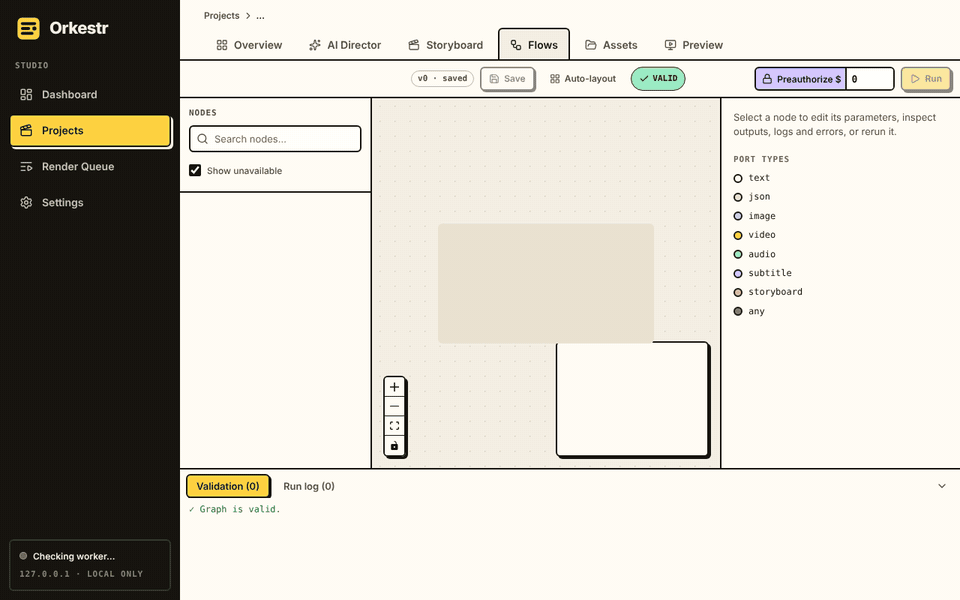
</details>

<details>
<summary><b>On a phone</b> — bottom tab bar, touch-sized controls, drawers instead of side panels</summary>
<br>
<p>
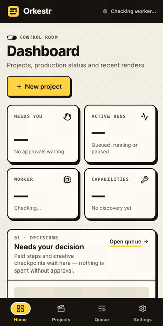
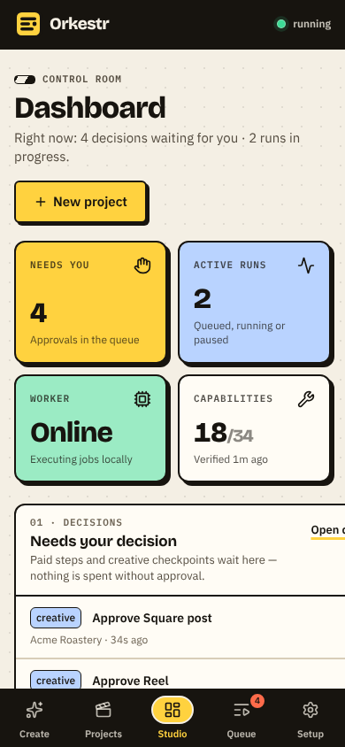
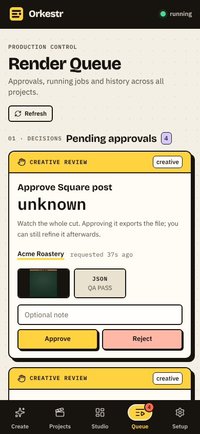
</p>
</details>

## Features

| Screen | What it does |
| --- | --- |
| **Dashboard** | Decisions waiting for you, active and recent runs, worker health, verified capabilities, projects, recent renders |
| **AI Director** | Brief → schema-validated plan (script, storyboard, shot list, deliverables, questions, risks) → accepted into a storyboard + workflow |
| **Storyboard** | Scenes with prompts, narration, on-screen text, durations and versions; approve/reject; regenerate a single scene |
| **Flow editor** | Typed drag-and-drop DAG (React Flow): live validation, auto-layout, save with version check, run with a preauthorized budget, live node status/progress/previews, logs, retry, selective rerun |
| **Assets** | Library with previews, metadata, provenance and lineage; upload and import from allowed folders |
| **Preview** | Player with subtitle overlay, scene timeline, audio takes, QA reports and exports |
| **Render queue** | Spend and creative approvals, every run with progress, cancel/retry/rerun, live event log |
| **Settings** | Capability matrix, environment, optional tools, Whisper models, encrypted credentials, budgets, import folders |

**Templates** (Flows → New workflow): Cinematic Commercial, Product Demo, Social Reel, Explainer Video — editable
JSON in [`/templates`](templates).

**Arabic and RTL** are first-class: user text is rendered with `dir="auto"`, Arabic runs use IBM Plex Sans Arabic,
captions and compositions support right-to-left layouts.

## How it works

```
 Brief ─▶ AI Director ─▶ validated plan ─▶ deterministic graph builder ─▶ workflow (DAG)
                                                                              │
             ┌────────────────────────── worker (durable queue) ◀──────────────┘
             ▼
   adapters (FFmpeg · Remotion · Playwright · whisper.cpp · Claude CLI · ElevenLabs · …)
             │                      ▲
             ▼                      │ only verified operations
   content-addressed asset store ── approvals (spend / creative) ── QA ── export
```

- **Next.js app** (`src/app`) — the studio UI and a local JSON API under `/api`.
- **Worker** (`worker/`) — the only process that executes nodes; durable, resumable, concurrency-limited.
- **Engine** (`src/server/engine`) — typed node registry, graph validation, caching, retries, selective rerun.
- **Adapters** (`src/server/adapters`) — one per tool; each declares the operations it verified at discovery time.
- **System prompts** (`src/server/prompts.ts`) — the four prompts Orkestr sends to Claude, in one file.
- **Remotion compositions** (`remotion/`) — Commercial, Poster, Loop and TestCard.

Read more in [ARCHITECTURE.md](ARCHITECTURE.md) and [WORKFLOW_ENGINE.md](WORKFLOW_ENGINE.md).

### AI prompts

Orkestr calls Claude in four places. Each call has no tools (the frame reviewer can only read the frames it is
given), must answer in a fixed JSON shape, and is capped by a budget you set.

| Prompt | When it runs | What it returns |
| --- | --- | --- |
| `DIRECTOR_SYSTEM` | The AI Director plans a brief | A plan: script, storyboard, deliverables, questions, risks |
| `EDIT_SYSTEM` | You refine a plan with "Use AI Director" | Edit operations, never a rewritten plan |
| `REVIEW_SYSTEM` | An `ai.review` node inspects rendered frames | A verdict and a list of visible issues (advisory only) |
| `WRITE_SYSTEM` | An `ai.write` node writes copy | The finished text |

All four live in [`src/server/prompts.ts`](src/server/prompts.ts). They tell the model how the engine will render
or apply its answer, limit product facts to your verified claims, and treat website text and other supplied
content as data, never as instructions. See [AI_ORCHESTRATION.md](AI_ORCHESTRATION.md#system-prompts).

### Capability matrix

`npm run discover` probes your machine and the Settings page shows the live result. An example from the
maintainer's Windows machine:

| Tool | Status | Verified operations |
| --- | --- | --- |
| FFmpeg / FFprobe | ✔ healthy | probe, encode (H.264/VP9), concat, mux/mix (loudnorm), subtitles (mov_text), frames, still→motion, seamless loop, poster frame |
| Remotion 4 | ✔ healthy | Commercial / Loop / TestCard render (H.264), Poster still |
| whisper.cpp | ✔ healthy | multilingual transcription with word timestamps → SRT |
| Playwright (Chromium) | ✔ healthy | real UI screenshot, scroll-recording |
| Claude Code CLI | ✔ healthy | AI Director plan, copywriting, frame review — schema-validated JSON, no tools |
| PhotoCraft / SoundCraft / EffectCraft / AniCraft / VectorCraft | ✔ healthy | image grade, audio normalize, VFX/animation renders, SVG/PDF rasterize |
| FilmCraft | ⚠ degraded | probe; TTS English only; no transcription in that build |
| ElevenLabs | ✘ unconfigured | TTS (paid) — needs an API key |
| ComfyUI, Runway, fal, Higgsfield | ✘ | no local server / no API key → **no AI image/video/music generation** |

Your matrix will differ — that is the point.

## Design system

The studio UI uses **"Call Sheet"**, a modern neo-brutalist system borrowed from the film set: warm paper canvas,
ink outlines, hard offset shadows, one signal-yellow accent and semantic pastel fills — bold where it guides
attention, quiet where you work for hours. Colour always means something, and status is never colour-only.

| Before | After |
| --- | --- |
| [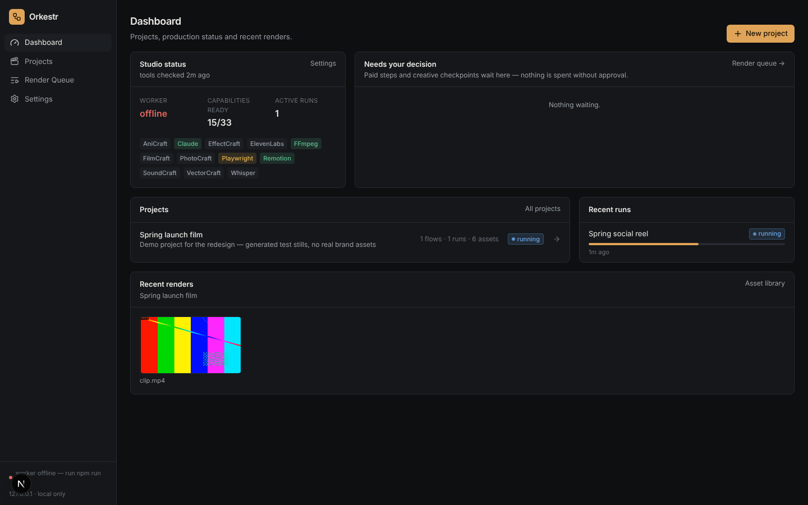](docs/redesign/before-dashboard.png) | [](docs/screenshots/dashboard.png) |

Tokens, type scale, elevation ladder, components, motion and accessibility rules are documented in
[DESIGN.md](DESIGN.md). Fonts (Bricolage Grotesque, IBM Plex Sans / Mono / Sans Arabic) are self-hosted via
`@fontsource`, so the app needs no network at runtime.

## Scripts

| Command | |
| --- | --- |
| `npm run dev` / `npm start` | studio + worker (dev / production build) |
| `npm run worker` | worker only |
| `npm run discover` | tool discovery + capability matrix |
| `npm run seed:demo` | create/refresh the dummy **Acme Café (demo)** project |
| `npm test` | unit + integration tests (integration tests use real, free local tools) |
| `npm run test:e2e` | Playwright browser tests (needs `npm run seed:demo` and `npm run dev`) |
| `npm run typecheck` | TypeScript |
| `npm run remotion:studio` | open the compositions in Remotion Studio |

## Documentation

| Document | Covers |
| --- | --- |
| [ARCHITECTURE.md](ARCHITECTURE.md) | processes, data model, storage, events |
| [WORKFLOW_ENGINE.md](WORKFLOW_ENGINE.md) | graph model, validation, scheduling, retries, caching, selective rerun |
| [TOOL_ADAPTERS.md](TOOL_ADAPTERS.md) | every adapter, its verified operations and limits |
| [AI_ORCHESTRATION.md](AI_ORCHESTRATION.md) | the AI Director, the four system prompts, schemas and guardrails |
| [PRODUCTION_GUIDE.md](PRODUCTION_GUIDE.md) | producing a piece end to end with the demo project |
| [SKILLS.md](SKILLS.md) | Claude Code skills shipped in `.claude/skills` |
| [SECURITY.md](SECURITY.md) | threat model, local-only API, secrets |
| [TESTING.md](TESTING.md) | test layers and how to run them |
| [DESIGN.md](DESIGN.md) | the "Call Sheet" design system |

## Limitations

- No AI image/video/music generation unless you add a provider adapter + credential; placeholders are clearly
  marked until then.
- Arabic voiceover needs ElevenLabs (or a recorded human take imported as an asset).
- Whisper captions must be proofread; `base` is weak on Egyptian dialect — install `small` / `medium`.
- Single user, single machine. The API trusts any local process that talks to `127.0.0.1` (see SECURITY.md).
- The studio UI ships a light theme only.
- Remotion is free for individuals and small teams; larger companies need a Remotion company licence.

## Contributing

Issues and pull requests are welcome.

1. `npm install`, `npm run discover`, `npm run seed:demo`, `npm run dev`.
2. Keep adapters honest: never expose an operation, price or result that discovery did not verify
   (see [TOOL_ADAPTERS.md](TOOL_ADAPTERS.md)).
3. UI changes follow [DESIGN.md](DESIGN.md) — use the tokens and components in `src/components/ui.tsx`.
4. Run `npm test`, `npm run typecheck` and (with the app running) `npm run test:e2e` before opening a PR.

## License

No license file has been added yet. Until one is, all rights are reserved by the author — please open an issue if
you want to use the code.
